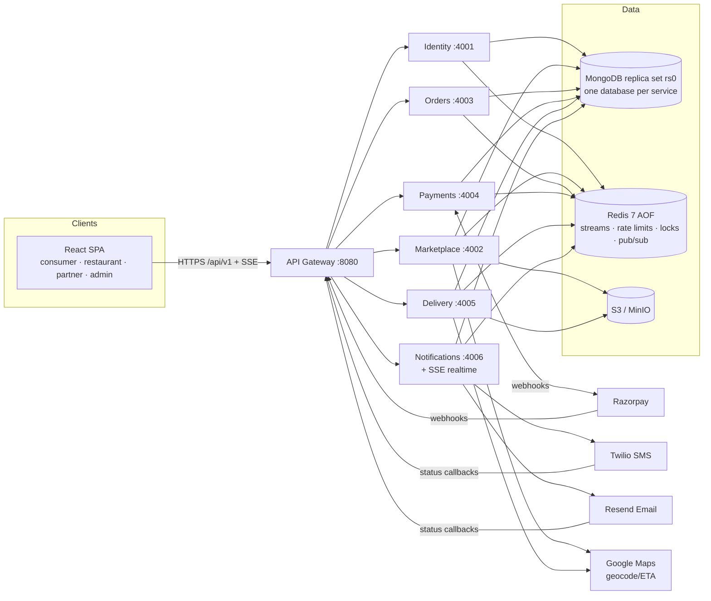

# HLD — Thali Food Delivery Platform

Companion docs: `01-PRD.md` (what), `03-LLD.md` (exact models/contracts), `04-ADR.md` (decisions).

## 1. System context



## 2. Service ownership

| Service | Owns (database `thali_<svc>`) | Key responsibilities |
|---|---|---|
| **gateway** | none (Redis for rate limits) | TLS termination point (behind LB), routing, CORS, rate limiting, request-id, body size limits, aggregated Swagger UI, admin health aggregation. Does **not** hold domain logic. |
| **identity** | users, otp_challenges, sessions, admin_credentials, audit_logs | Phone OTP, admin password + TOTP MFA, JWT issuing (EdDSA) + JWKS, sessions/refresh rotation/revocation, profiles, addresses, notification prefs, role grants, central audit store (consumes `audit.recorded`). |
| **marketplace** | restaurants, menu_categories, menu_items, stock_reservations, service_areas, cuisines, banners, coupons, coupon_redemptions, membership_plans, memberships, ratings | Restaurant onboarding + business email verification + approval states, menus & stock, discovery/search/serviceability, coupons, banners, memberships (plans + entitlements + usage). **Stock reservations live here** (refinement — see ADR-004). |
| **orders** | carts, checkout_groups, child_orders, order_events, support_tickets, restaurant_projection | Carts (guest + user), checkout orchestration (saga), pricing (via `@thali/pricing`), child-order lifecycle, acceptance timeouts, parent-status derivation, support tickets (refinement — ADR-005). |
| **payments** | payment_intents, payment_events, refunds, ledger_entries, payouts, membership_purchases_payments | Provider orders, webhook verification/dedupe, reconciliation, refunds, financial ledger (restaurant & partner earnings), recorded payouts. |
| **delivery** | partners, partner_documents, delivery_jobs, delivery_offers, location_pings | Partner onboarding/approval, availability, dispatch offers, atomic acceptance, batching policy, pickup/drop verification, live location, delivery exceptions. |
| **notifications** | notifications, notification_templates, provider_callbacks | SMS/email/in-app delivery with retries + DLQ, provider callbacks, **SSE realtime hub** (Redis pub/sub fan-out). |

Rules: a service touches only its own database. Cross-service reads go through internal HTTP
APIs or event-fed local projections (e.g. orders keeps `restaurant_projection`).

## 3. Communication

### 3.1 Synchronous (HTTP/JSON)
- **External**: SPA → gateway `/api/v1/...` → service. Gateway prefix map:

| Prefix | Service |
|---|---|
| `/api/v1/auth`, `/api/v1/me`, `/api/v1/admin/users`, `/api/v1/admin/audit-logs`, `/.well-known/jwks.json` | identity |
| `/api/v1/discovery`, `/api/v1/restaurants`, `/api/v1/owner/restaurants`, `/api/v1/coupons`, `/api/v1/memberships`, `/api/v1/banners`, `/api/v1/cuisines`, `/api/v1/admin/marketplace` | marketplace |
| `/api/v1/cart`, `/api/v1/checkouts`, `/api/v1/orders`, `/api/v1/owner/orders`, `/api/v1/support`, `/api/v1/admin/orders`, `/api/v1/admin/support` | orders |
| `/api/v1/payments`, `/api/v1/webhooks/razorpay`, `/api/v1/finance`, `/api/v1/admin/finance`, `/api/v1/demo-pay` | payments |
| `/api/v1/partner`, `/api/v1/deliveries`, `/api/v1/admin/delivery` | delivery |
| `/api/v1/notifications`, `/api/v1/realtime`, `/api/v1/webhooks/twilio`, `/api/v1/webhooks/resend` | notifications |
| `/api/v1/meta`, `/api/v1/admin/health`, `/api/docs` | gateway itself |

- **Internal**: service → service at `http://<svc>:<port>/internal/...` on the private Docker
  network with a short-lived **service token** (HS256, `iss=<caller>`, `aud=<callee>`, 60 s)
  signed with `INTERNAL_SERVICE_SECRET`. Internal routes are never mounted on the gateway.
- Every outbound call: timeout (default 3 s, provider 10 s), `x-request-id` propagation,
  bounded retries only for idempotent operations.

### 3.2 Asynchronous (events)
- **Transactional outbox** per service: state change + `outbox` document written in the same
  Mongo transaction. A relay (leader-locked) publishes to **Redis Streams**
  `events.<domain>` (e.g. `events.orders`) and marks the outbox row published.
- Consumers use **consumer groups** (`cg.<service>`); every handler is idempotent via an
  **inbox** collection (`_id = eventId`) written in the same transaction as the handler's
  effects.
- Failures: retry with exponential backoff (1 s → 2 → 4 … max 5 attempts via XCLAIM of idle
  pending entries); then move to `dlq.<service>` stream + `dead_letters` collection, visible
  in admin health with **replay** action.
- Redis runs with `appendonly yes`, `appendfsync everysec`. The outbox is the source of truth;
  relay can re-publish (consumers dedupe).

### 3.3 Real-time
- Notifications service exposes `GET /api/v1/realtime/stream` (SSE). Auth via access token
  in query param is avoided: SPA first calls `POST /api/v1/realtime/ticket` (auth header) to
  get a 30 s single-use ticket, then opens `EventSource(/api/v1/realtime/stream?ticket=...)`.
- Fan-out across instances via Redis pub/sub channels `rt:user:<userId>`, `rt:owner:<ownerUserId>`,
  `rt:partner:<partnerUserId>`, `rt:admin`.
- **Fallback**: when SSE disconnects, SPA polls the relevant REST resource every 10 s and shows
  "Live updates paused — refreshing every 10 s".
- Location: partner app posts `POST /api/v1/deliveries/:id/location` (≤ 1 per 5 s). Delivery
  service stores the latest point, publishes `rt` message via Redis pub/sub (ephemeral; not
  on the durable stream). Consumer UI shows `last updated Xs ago`, stale after 60 s.

## 4. Key flows

### 4.1 Checkout → payment → orders (saga)

```mermaid
sequenceDiagram
  autonumber
  participant SPA
  participant OR as Orders
  participant MK as Marketplace
  participant PY as Payments
  participant RZ as Razorpay
  SPA->>OR: POST /checkouts (Idempotency-Key)
  OR->>MK: POST /internal/quote (items, address) — prices, open, stock, serviceability
  OR->>MK: POST /internal/coupons/validate + memberships/benefits
  OR->>OR: compute pricing (@thali/pricing)
  OR->>MK: POST /internal/reservations (checkoutId, items, 15 min TTL) — atomic stock hold + coupon hold
  OR->>OR: txn: CheckoutGroup + ChildOrders (AWAITING_PAYMENT) + outbox checkout.created
  OR->>PY: POST /internal/payment-intents (checkoutId, amount) idempotent
  PY->>RZ: POST /v1/orders (amount, receipt=checkoutId)
  PY-->>OR: intent {providerOrderId, keyId}
  OR-->>SPA: 201 checkout {status: AWAITING_PAYMENT, payment}
  SPA->>RZ: Razorpay Checkout (hosted)
  RZ-->>PY: webhook payment.captured (signed)
  PY->>PY: verify signature, amount, currency, receipt; dedupe; txn: intent CAPTURED + outbox payment.captured
  PY--)OR: event payment.captured
  OR->>OR: txn: inbox + children PLACED (acceptBy=now+5m) + outbox order.placed ×N
  OR--)MK: event checkout.confirmed → commit reservations & coupon redemption
  SPA->>OR: GET /checkouts/:id (poll / SSE) → PLACED
```

Failure branches:
- **Payment failed / abandoned**: `payment.failed` or expiry sweeper (after provider
  reconciliation says unpaid) → children `PAYMENT_FAILED`/`EXPIRED`, `checkout.released` →
  marketplace releases reservations & coupon hold.
- **Captured after expiry** (late payment): orders refuses to place, emits
  `checkout.late_payment` → payments issues full refund automatically.
- **Orders down when captured**: event waits in stream/outbox; when orders recovers it
  processes it (idempotent). Reservation TTL is extended by the payment-intent "in-flight"
  window; sweeper always reconciles with provider before expiring.
- **Duplicate submit**: same Idempotency-Key → same response; different key while an active
  AWAITING_PAYMENT checkout exists for the same cart version → returns that checkout.

### 4.2 Partial rejection

```mermaid
sequenceDiagram
  participant RA as Restaurant A
  participant RB as Restaurant B
  participant OR as Orders
  participant PY as Payments
  participant C as Customer
  RA->>OR: POST /owner/orders/A1/accept
  OR--)C: order.accepted (A1)
  RB->>OR: POST /owner/orders/B1/reject {reason}
  OR->>OR: B1 REJECTED, refundStatus=REQUESTED, outbox order.rejected{refundPaise=B1.total}
  OR--)PY: order.rejected
  PY->>PY: Refund(idemKey=refund:B1:REJECTED) REQUESTED→PROCESSING, POST /payments/:id/refund
  PY--)OR: refund.processing / refund.succeeded (after webhook)
  OR--)C: "Restaurant B declined — ₹X refund initiated; A continues"
  Note over OR: Parent status = IN_PROGRESS → PARTIALLY_FULFILLED when A1 delivered
```

### 4.3 Delivery
`order.accepted` → delivery creates `DeliveryJob(PENDING_ASSIGNMENT)` → dispatcher creates
offers for the nearest eligible online partners (batching policy) with TTL → first atomic
accept wins → `delivery.assigned` → partner arrives, enters restaurant pickup code →
`delivery.picked_up` → orders `PICKED_UP`, then `OUT_FOR_DELIVERY` on `delivery.started` →
customer delivery code → `delivery.delivered` → orders `DELIVERED` → payments posts ledger
earnings. Unassigned after N dispatch rounds → `delivery.exception` → admin TMS queue.

## 5. Identity & security architecture
- **Tokens**: Access JWT (EdDSA/Ed25519, 15 min, claims `sub, roles, sid, amr`) verified
  locally by every service via JWKS fetched from identity (cached). Refresh token: opaque
  random 256-bit, stored hashed in `sessions`, rotated on every use with reuse detection
  (reuse → revoke session family). Sent as `__Host-`-style httpOnly, Secure (prod),
  SameSite=Strict cookie `thali_rt`, path `/api/v1/auth`.
- **Revocation**: logout deletes session and writes `revoked:sid:<sid>` in Redis (TTL 15 min);
  services check this key in the auth middleware.
- **CSRF**: only the refresh/logout endpoints use the cookie; they require header
  `X-Requested-With: thali-web` and an allowed `Origin`. All other APIs use bearer tokens.
- **Admin**: password (argon2id m=19 MiB, t=2, p=1) + TOTP; access token `amr` includes
  `mfa`; admin routes require role `ADMIN` + `amr⊇mfa`.
- **RBAC + ownership**: route-level role guard + resource ownership checks in handlers
  (e.g. `childOrder.restaurantOwnerId === user.sub`).
- **Files**: uploads go to S3 via presigned PUT with content-type + size constraints; service
  validates magic bytes after upload (HEAD + range GET) before attaching. Private bucket for
  documents (signed GET 5 min, admin/owner only); public bucket for images.
- **Secrets**: env only, `.env` git-ignored; settlement bank details AES-256-GCM encrypted with
  `FIELD_ENCRYPTION_KEY`; logs redact `authorization, cookie, otp, password, token, account*`.

## 6. Provider adapters

Each integration is an interface in `packages/service-kit/providers` (or service-local) with
`mock` and real implementations selected by env:

| Port | Real adapter | Mock (demo only) | Callback |
|---|---|---|---|
| SmsProvider | Twilio Messages API | writes to `notifications` + console, labeled DEMO | Twilio status callback (X-Twilio-Signature) |
| EmailProvider | Resend `POST /emails` | Mailpit SMTP container (local inbox at :8025) | Resend webhooks (Svix signature) |
| PaymentProvider | Razorpay Orders/Payments/Refunds | Demo pay page that emits **signed** mock webhooks through the same webhook pipeline | Razorpay webhook (X-Razorpay-Signature) |
| GeoProvider | Google Geocoding + Routes | Haversine × 1.3 road factor ÷ 20 km/h, labeled "demo estimate" | — |
| ObjectStorage | AWS S3 | MinIO (same S3 API) | — |
| PayoutProvider | Manual settlement recorder (UTR) | same | — |

Production startup refuses `*_PROVIDER=mock`.

## 7. Deployment view
- **Local**: `docker compose up` — mongo (rs0, keyfile auth), redis (AOF), minio + bucket init,
  mailpit, 6 services, gateway, web (nginx serving the built SPA and proxying `/api`).
- **Staging/Prod (recommended)**: containers on a managed runtime (AWS ECS Fargate / Fly.io /
  Render); MongoDB Atlas (replica set, PITR backups); managed Redis with AOF (Elasticache /
  Upstash); S3; ALB with TLS; secrets in AWS Secrets Manager; one image per service; CI builds,
  tests, pushes, deploys. Kubernetes not required for pilot.
- **Scaling path**: stateless services scale horizontally; relays and sweepers use Redis locks
  (single active leader); SSE uses Redis pub/sub; Mongo indexes defined in LLD; move streams
  to a dedicated broker (NATS JetStream / Kafka) when throughput requires.

## 8. Observability & operations
- pino JSON logs: `{service, reqId, userId?, eventId?, msg}`; `x-request-id` generated at
  gateway and propagated through HTTP and event envelopes (`correlationId`).
- `/health/live` (process) and `/health/ready` (Mongo ping, Redis ping) per service;
  `/internal/health/details` adds outbox backlog, consumer lag, DLQ size, provider error counts.
- Admin health page aggregates all of the above live.
- Recovery sweepers (leader-locked, every 30 s): expire/reconcile checkouts, acceptance
  timeouts, offer expiry/re-dispatch, refund status reconciliation, notification retries,
  stuck outbox rows.
