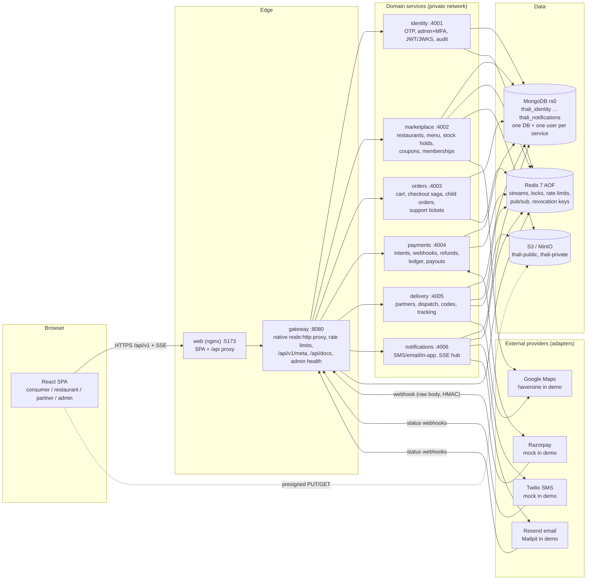
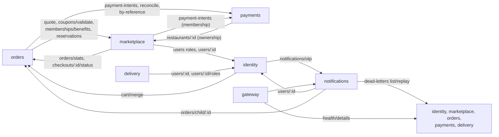
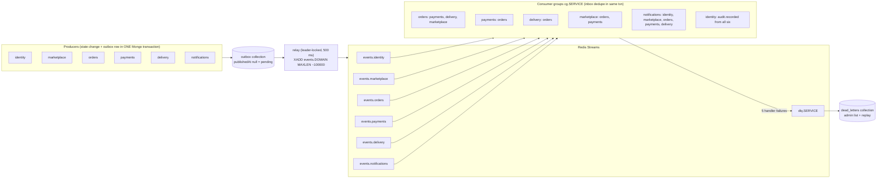
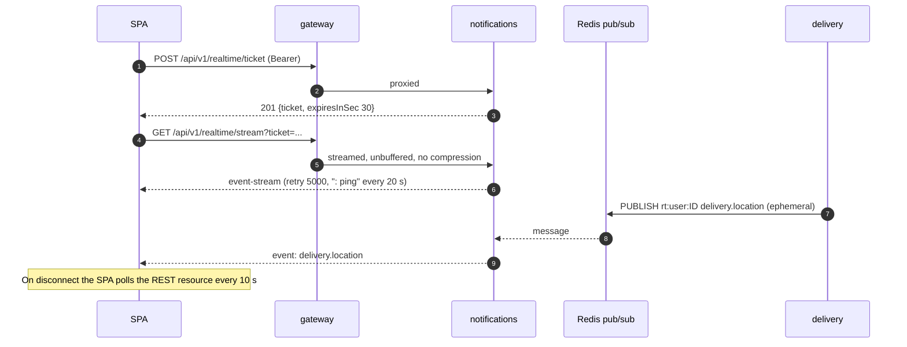
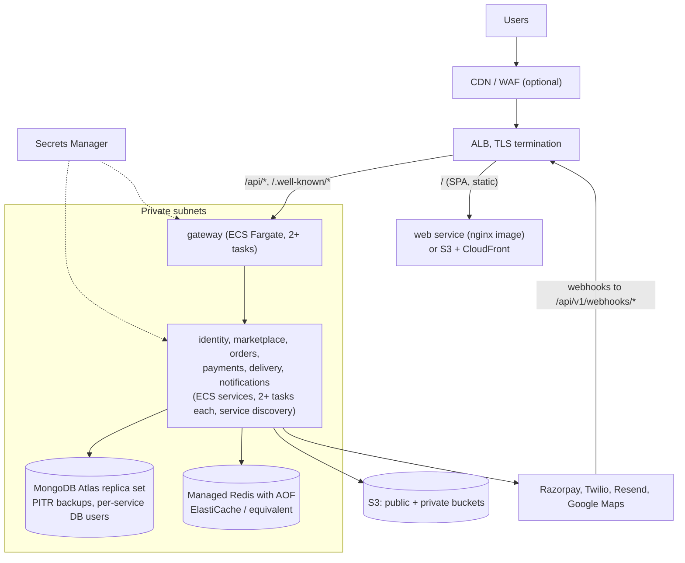

# Architecture diagrams

All diagrams are Mermaid and render on GitHub and most Markdown viewers. They describe what the code
does (services in `services/*`, compose in `docker-compose.yml`). Companion docs: [HLD](../02-HLD.md),
[LLD](../03-LLD.md), [ADRs](../04-ADR.md).

## 1. System architecture (local full stack)

Notes
- Only `web`, `gateway`, Mailpit and MinIO publish host ports. Mongo, Redis and the six services are on the
  compose network only (the `debug` profile adds a loopback forwarder).
- `/internal/*` is never routed by the gateway; services call each other directly with HS256 service tokens
  (`iss=<caller>`, `aud=<callee>`, 60 s) signed with `INTERNAL_SERVICE_SECRET`.
- A service reads and writes only its own database. Cross-service data moves through internal HTTP or events.

## 2. Synchronous internal calls

## 3. Event backbone (transactional outbox + Redis Streams)

Delivery guarantee: at-least-once publish (a crash between XADD and the `publishedAt` mark republishes),
exactly-once effect (inbox `_id = eventId`, written in the same transaction as the handler's writes).
Retry backoff 1 s, 2 s, 4 s ... up to 5 handler attempts, then dead-letter. Mongo or Redis outages are
treated as infrastructure errors: the consumer pauses and resumes, it does not burn handler attempts.

## 4. Real-time path (SSE)

## 5. Deployment topology (recommended staging / production)

See [06-deployment.md](../06-deployment.md) for the details behind each box.
