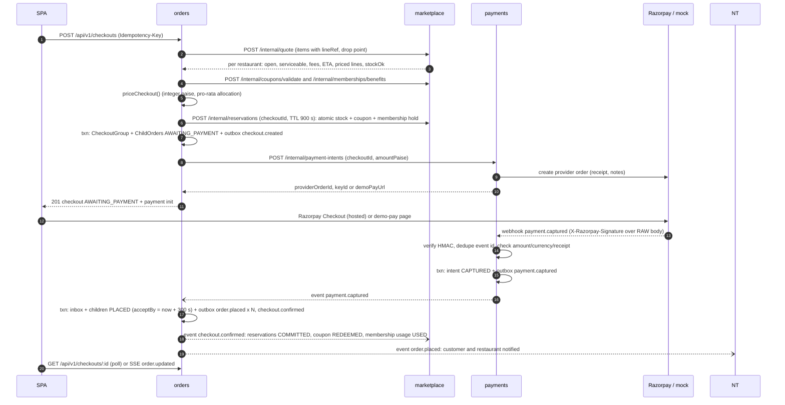
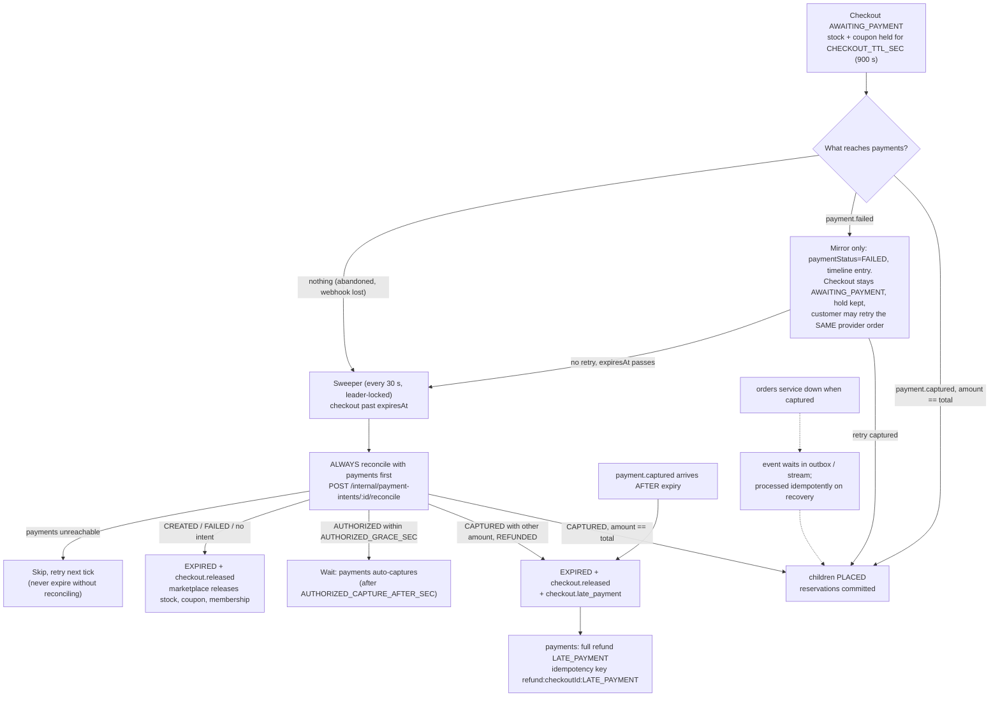
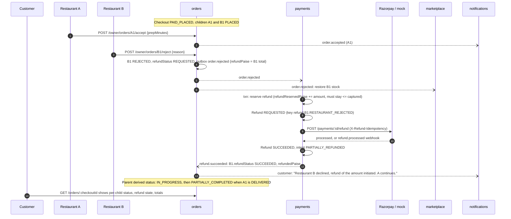
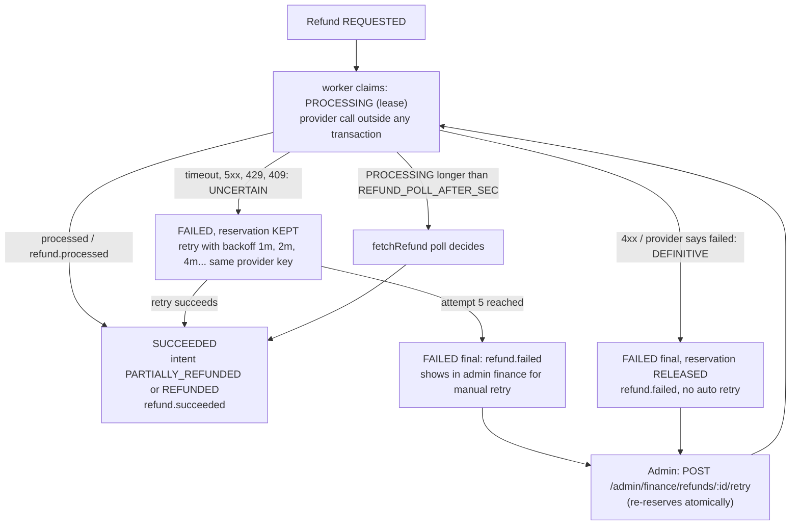
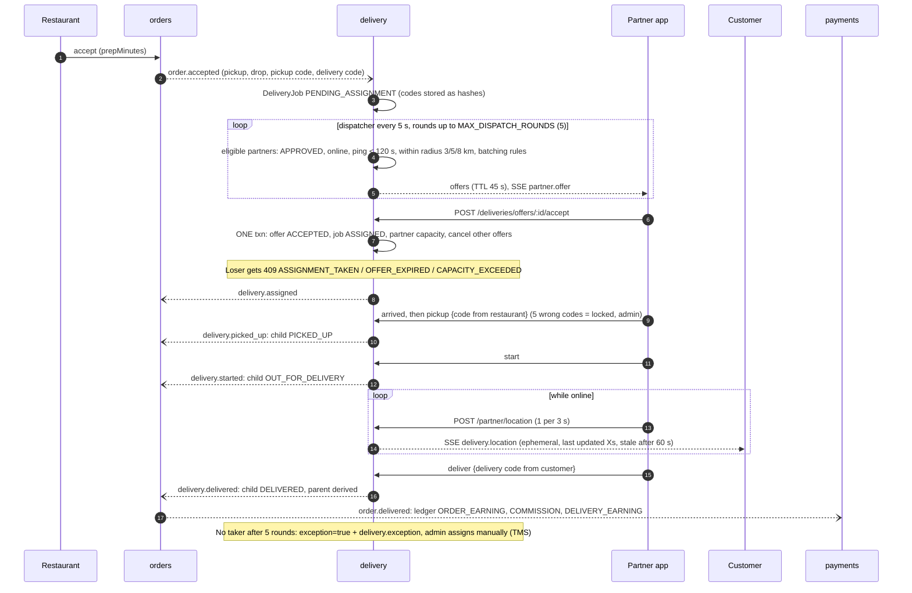

# Checkout, payment, order, refund and delivery flows

Mermaid sequence and flow diagrams of the money and order paths as implemented. State machines are in
[state-machines.md](state-machines.md). Abbreviations: OR orders, MK marketplace, PY payments,
DL delivery, NT notifications, RZ Razorpay (or the mock provider in demo).

## 1. Checkout to PLACED (happy path)

## 2. Failure branches

Rules worth remembering
- A duplicate webhook (same event id, or same body hash when the provider sends no id) is stored as
  `IGNORED_DUPLICATE` and never produces a second event.
- An event that implies an earlier state (for example `payment.authorized` after CAPTURED, or `payment.failed`
  after CAPTURED) is stored as `IGNORED_STALE` and alerted, never applied.
- `POST /payments/:intentId/verify` (customer) can only trigger a provider reconcile. It never marks an
  intent paid by itself.
- A different amount, currency or receipt than the intent is `REJECTED_MISMATCH` with an
  `alert: PAYMENT_MISMATCH` error log and no event.

## 3. Partial rejection and refund

Refund failure handling

## 4. Delivery flow

