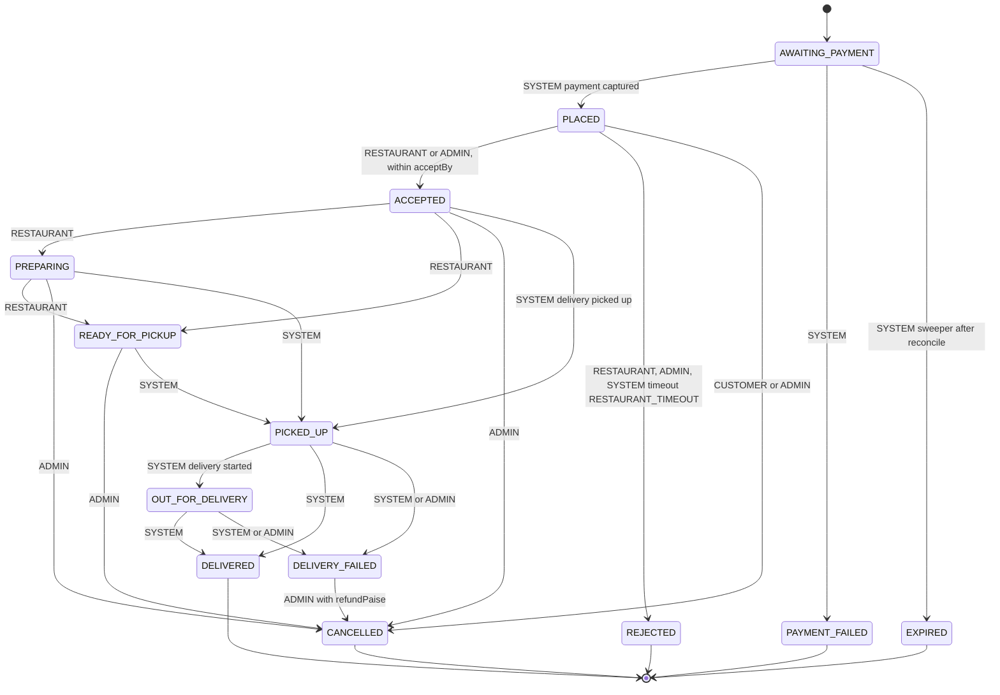
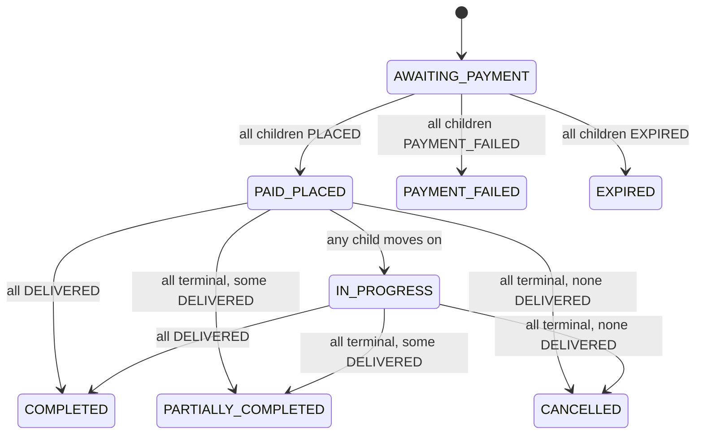
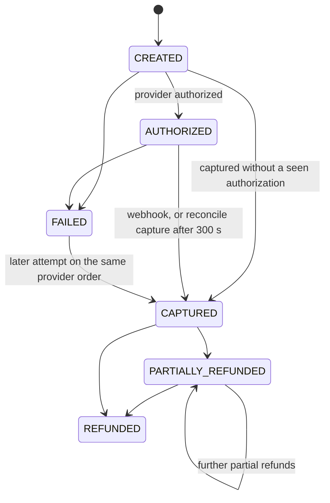
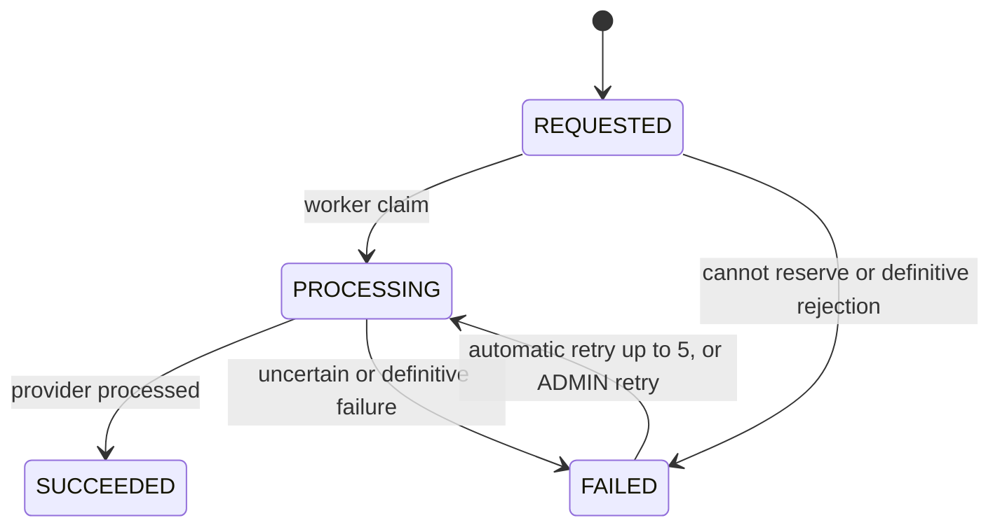
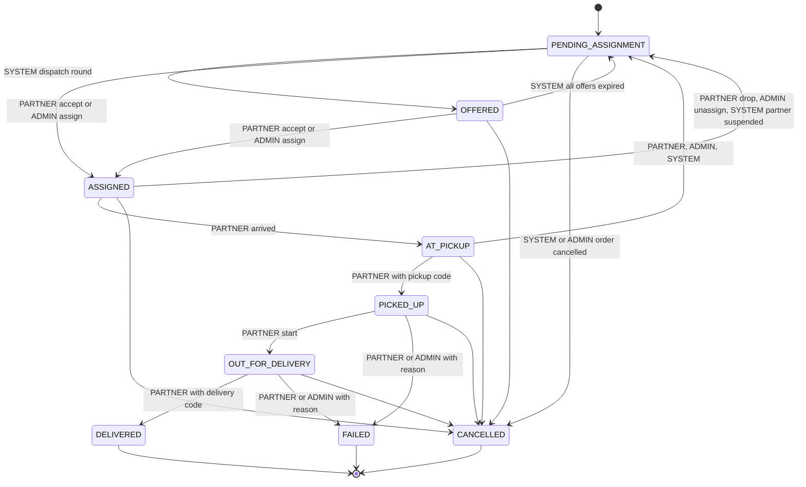
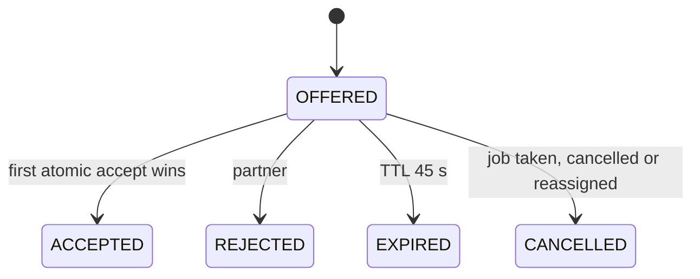
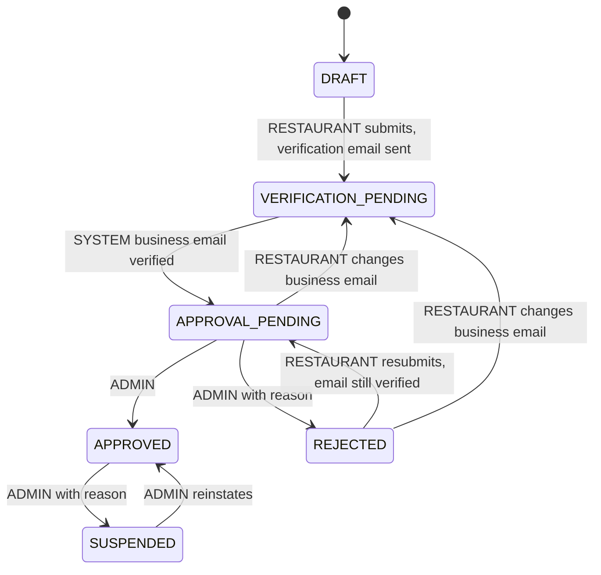
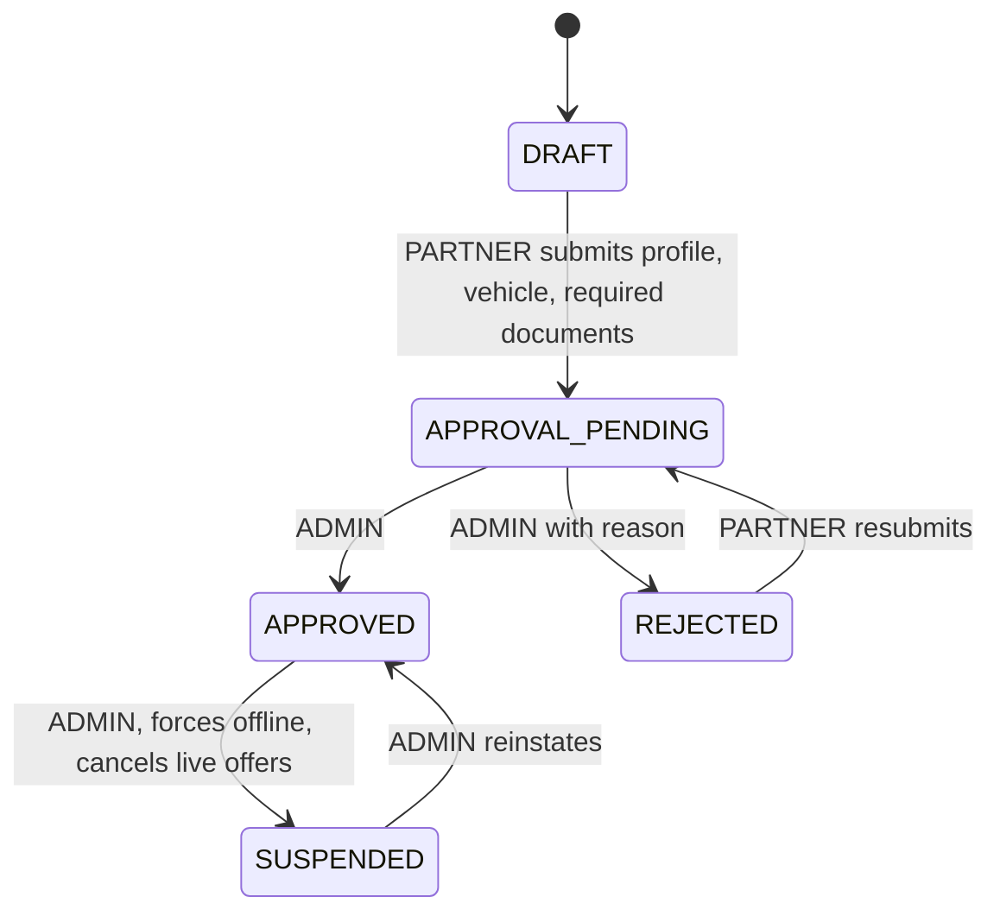
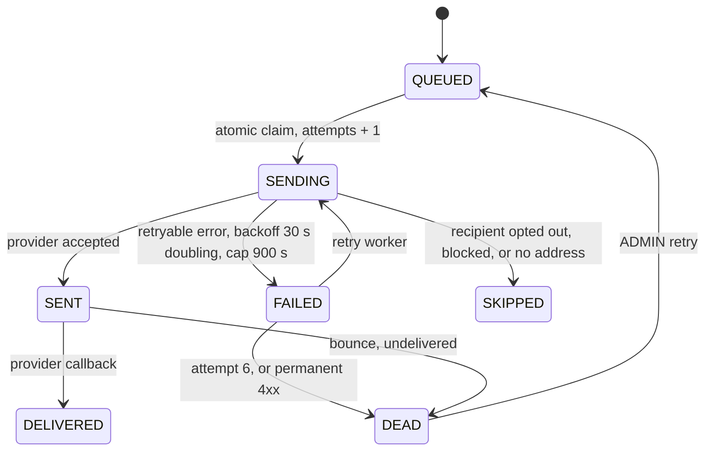

# State machines

Source of truth: `packages/contracts/src/state-machines.ts` (transition tables with the allowed actors),
enforced in every service by `assertTransition`. The diagrams below are drawn from those tables.
`SYSTEM` means an event consumer, sweeper or worker; `ADMIN` actions are audited.

## 1. Child order (one per restaurant)

Terminal: DELIVERED, REJECTED, CANCELLED, PAYMENT_FAILED, EXPIRED. DELIVERY_FAILED is deliberately not
terminal (it waits for an admin decision). A restaurant acting after `acceptBy` gets 409
`ORDER_ACCEPT_WINDOW_EXPIRED`. The admin transition endpoint (`POST /api/v1/admin/orders/child/:childId/transition`)
can only perform the rows whose actors include ADMIN.

## 2. Checkout group (derived from its children)

`deriveCheckoutStatus(children, current)`: any AWAITING_PAYMENT keeps AWAITING_PAYMENT; all PAYMENT_FAILED or
all EXPIRED map to the same checkout state; when all children are terminal the result is COMPLETED,
PARTIALLY_COMPLETED or CANCELLED; otherwise all PLACED is PAID_PLACED and anything else IN_PROGRESS.
A DELIVERY_FAILED child is non-terminal, so the parent stays IN_PROGRESS until an admin cancels it.

## 3. Payment intent

All transitions are SYSTEM. Out-of-order events that imply an earlier state are recorded as
`IGNORED_STALE` and do not change the intent.

## 4. Refund

## 5. Delivery job

After `MAX_DISPATCH_ROUNDS` (5) with no taker the job keeps its status but is flagged `exception=true`
(`delivery.exception`), auto-dispatch stops and an admin assigns manually. Five wrong handover codes lock the
job (HTTP 423); only an admin fail or reassignment clears it.

## 6. Delivery offer

## 7. Restaurant onboarding

Email verification and admin approval are separate gates. Public discovery requires `APPROVED`, not paused,
and the restaurant location inside the same active service-area polygon as the drop point (ADR-016).

## 8. Delivery partner

Only `APPROVED` partners can go online or receive offers (403 `PARTNER_NOT_APPROVED` otherwise). Going offline
while holding jobs returns 409 `PARTNER_HAS_ACTIVE_JOBS` (ADR-020). Demo mode may mark uploaded documents
`demoVerified`, but approval is always an admin action.

## 9. Notification

